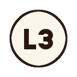

# Eternal Darkness for the PlayStation 5

**Eternal Darkness: Sanity's Requiem** (GameCube, 2002) as PS5 homebrew, title
`PPSA99314`, at 4K and 60 frames a second, built from
[Eternal Darkness Recomp](https://github.com/griches/EternalDarknessRecomp) and
**your own disc**. Version 0.8.0.

> **European disc only.** You need your own image of the **European GameCube disc,
> `GEDP01`**. The USA disc (`GEDE01`) is not supported.

## What you need

- A PS5 that runs homebrew (etaHEN or similar), with **ShadowMountPlus** and an
  **FTP server** (port 2121).
- Your own image of the European disc: an `.iso` or `.gcm` file (not a
  compressed RVZ or CISO).
- On your computer: an FTP program (FileZilla, for example) and a program that
  opens `.7z` files (7-Zip on Windows, Keka or The Unarchiver on a Mac).

## Set it up

### 1. The game

1. Download `EternalDarkness-PS5-....zip` from the
   [latest release](https://github.com/griches/PS5_EternalDarkness/releases/latest)
   and unzip it. You get a folder called `PPSA99314`.
2. Copy that folder to the console over FTP, as `/data/homebrew/PPSA99314/`.
3. Copy your disc image into `/data/homebrew/PPSA99314/dump/`. Any file name
   works.

### 2. The HD textures (recommended)

Two downloads, both DDS:

| Download | What it is | Size |
| --- | --- | --- |
| **[Eternal Darkness HD Texture Pack](https://mega.nz/file/6m5TQToI#v09Y_gYdtZ24WTT6BlfCeM5uvw1nRs3QozcYZkUVVqg)** by Zombie | The game's textures redrawn at four times the detail | 2.9 GB `.7z` on Mega |
| **[PAL supplement](https://www.bouncingball.mobi/eternaldarkness/files/ED-PAL-supplement-dds.zip?v=2)** by Eternal Darkness Recomp | What the pack misses on the European disc: the Jump to Game, Options and Language screens and the title menu's words, and highlights without hard edges | 10.7 MB `.zip` |

1. Unpack both on your computer. Each one gives you a folder.
2. Make a folder called `textures` in `/data/homebrew/PPSA99314/` and copy both
   folders into it. The pack is a few GB, so this takes a while.

Leave both folders as they are: the supplement replaces some of the pack's
textures on purpose, and a folder with *supplement* in its name always wins.
DDS stays compressed in the console's graphics memory, a quarter of the room
PNG takes. PNG versions of both are on the
[website](https://www.bouncingball.mobi/eternaldarkness/#hd) if you need them.

The pack is the work of **Zombie**, shared on the
[Dolphin forums](https://forums.dolphin-emu.org/Thread-eternal-darkness-hd).

### 3. Check the folder

When you're done it looks like this:

```
/data/homebrew/PPSA99314/
├── eboot.bin, sce_sys/, res/, ...    from the release zip
├── dump/
│   └── your disc image (.iso or .gcm)
└── textures/
    ├── GED DDS 1.0/                   Zombie's pack (any folder name works)
    └── Eternal Darkness HD Texture Pack PAL supplement/
```

### 4. Play

1. Start **Eternal Darkness** from the home screen.
2. The first start reads the game's program from your disc, which takes a
   second or two. Then the launcher shows your disc.
3. Choose **New game**.

The defaults are already the best picture: 4K, widescreen, HD textures on and
sharp baked shadows. In **Options > Game**, **HD textures** should say **On**,
and its note gives the number of textures it found.

### If something's wrong

- **It isn't on the home screen**: restart ShadowMountPlus (or the console).
- **The launcher's Disc says None found**: the image isn't in `dump/`, or it's
  a compressed RVZ or CISO. A USA disc shows up but can't be played.
- **HD textures says No pack**: the pack isn't inside `textures/`. Check the
  folder against the one above, then close the game and start it again: it
  looks for the pack as it starts.

### Updating

Copy a new release's `PPSA99314` folder over the old one. Saves, settings, your
disc and the textures stay as they are: saves and settings live in
`/data/homebrew/PPSA99314/` (`saves/`, `settings.ini`, and the memory cards
`ed-GEDP01-slot-a.dolcard` and `...-slot-b.dolcard`).

The game's files (its program, graphics, sound and music) come from your disc.

## What is better than on the GameCube

- **4K at 60 frames a second**, with full colour (no 6-bit banding). Options can
  also draw at 720p, 1080p or 1440p.
- **Widescreen**: the game's own 16:9 mode (more of the room at the sides, not
  stretched) with the HUD and prompts at the screen's edges; 4:3 too.
- **New baked shadows** (below): the rooms' light and shadow redrawn sharp.
- **Crisp game text**: the game's lettering redrawn in two styles, *Sharp* or
  *Tome* (old typefaces), or *Original* as on the disc.
- **HD texture packs** in Dolphin's format.
- **Modern controls** and remapping, with PlayStation button prompts, the game's
  own prompts included (the icons below are the game's own).
- **Save anywhere**: the pause menu has four save slots that hold the whole
  moment, besides the game's own memory-card saves (slots A and B).
- **A launcher**: Continue, New game or any save slot straight from the start.
- **Problem reports**: if the game stops responding, stops or crashes, it says
  so on screen and writes a report to `saves/reports/` (fetch it over FTP and
  send it with a few words on what you were doing).
- **Shaders ready**: the title ships the shader caches a console made, so a fresh
  install starts without compiling them.

## Controls

| Action | Modern (default) | Original (GameCube positions) |
| --- | --- | --- |
| Move |  |  |
| Attack / Confirm |  or  |  |
| Action / Cancel |  |  |
| Target / Aim |  or  |  |
| Sprint |  toggle, or hold  |  |
| Creep |  toggle |  |
| Reload |  |  |
| Quickcast |  |  |
| Spells |  |  |
| Game's pause menu |  |  |
| This port's menu (saves, options) |  |  |

In the game's own menus L1 and R1 page left and right. **Options > Controls**
switches layout, makes Sprint, Creep and Target hold or toggle, sets the stick
deadzone and vibration, and **Button mapping** rebinds any action (that layout is
*Custom*).

## The new baked shadows

Eternal Darkness lights its rooms with pre-drawn light maps: the window light on
the floors, the shadows under the furniture, the glow of the lamps. On the disc
they are small and compressed, so at 4K their edges break up into blocks and
smears. With **Options > Game > Baked shadows: Sharp** (the default) each room's
light maps are rebuilt four times larger as the room loads, with the compression
blocks evened out and edges doubled along their own direction, so light and
shadow keep clean edges. **Original** shows them as on the disc.

## How it works

- `vendor/edrecomp` is the recomp (a submodule): its host layer, launcher and
  build. What the console needs changed in it is `ps5/patches/edrecomp.patch`,
  every hunk behind `__PROSPERO__`.
- `ps5/tools/setup-source.sh` fetches the two projects the recomp builds on at
  its pins (DolRecomp, GXRuntime) with its patches and then the console's
  (`ps5/patches/gxruntime.patch`), builds the recompiler for the build machine,
  and translates `main.dol` from the disc in `dump/` into `gamedata/<id>/`.
- Graphics are GXRuntime's gxcore renderer on Aurora and Dawn (WebGPU), Dawn's
  Vulkan backend running on the RADV driver linked into the title
  ([PS5_Vulkan](https://github.com/mihawk-99/PS5_Vulkan)). `ps5/patches/dawn.patch`
  adds the console to Dawn: the driver linked in, and the output as a
  VK_KHR_display surface. SDL3 gets the console's video, audio and pad drivers
  (`ps5/sdl`, `ps5/patches/sdl.patch`).
- `ps5/src/startup.c` runs before the game: klog, the title folder as the
  working folder (the recomp finds `generated/main.dol`, `dump/<id>.iso`,
  `res/`, `saves/` and `settings.ini` there) and the caches in `cache/`.
- `ps5/shader-cache` holds the shader caches a console filled (Dawn's
  `dawn_cache.db` and the driver's `radv-shader-cache`). `link-title.sh` puts them
  in `res/shader-cache` and `startup.c` copies them into place on a start that has
  none. Take them from a console again after a change to Dawn, Mesa or the
  shaders.

## Build

From macOS, through the Lima VM `ps5` that holds the PS5 stack (PS5_Vulkan,
PS5_Mesa, PS5_PayloadSDK, LLVM 22):

```sh
git submodule update --init
cp /path/to/GEDP01.iso dump/            # your own European disc
ps5/tools/vm.sh build                   # -> dist/PPSA99314/
ps5/tools/vm.sh deploy                  # FTP to the console (PS5_HOST)
ps5/tools/vm.sh run                     # launch and follow klog
```

On the console the title folder also needs the disc, `dump/<id>.iso` under
`/data/homebrew/PPSA99314/`; the title reads `generated/main.dol` out of it on
its first start (`ps5/tools/console.sh game-files` copies both instead).
`ps5/tools/package-release.sh VERSION` zips `dist/PPSA99314/` for a release, with an empty
`dump/` for the disc.
`ps5/tools/console.sh` also deploys and runs from macOS itself, for when the VM
cannot reach the console, and writes the title's `env.txt`: `KEY=VALUE` lines
the recomp reads as its environment (for example `ED_QUICKLOAD=saves/slot1.state`
to start in a save, `AURORA_GPU_TIME_LOG=1` for frame times in klog).

The home-screen art (`ps5/art`, converted by `ps5/art/make-title-art.sh`) is
the port's own, made with ChatGPT in the look of the game's cover; nothing in it
is from the game. The music that plays while the tile is highlighted is: the
first 30 seconds of one of the game's insanity themes, in
`ps5/sce_sys/snd0.at9`. `ps5/art/make-title-music.sh` remakes it from a disc
(needs FFmpeg and [ps5-at9-converter](https://github.com/blackbearreloaded/ps5-at9-converter)
beside this repo).

## Licence

GPL-3.0-or-later, as Eternal Darkness Recomp and GXRuntime. The PS5 layer
(`ps5/src`, `ps5/sdl`, `ps5/tools`) comes from the author's other PS5 ports.
The title carries every component's licence text in `licenses/` (the recomp's
`THIRD_PARTY.md` lists them, and SDL, Dawn, Mesa and PS5_Vulkan are added).
